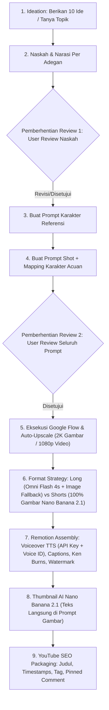

# Panduan Alur Produksi Video Baku (9 Tahapan)

MoneyPrinterMax menerapkan alur kerja yang terstandarisasi ketat agar menghasilkan video berkualitas tinggi dengan visual konsisten, narasi memikat, dan tanpa risiko pemborosan kredit AI.

---

## 🗺️ Diagram Alur 9 Tahapan

---

## 📌 Penjelasan Rinci Setiap Tahap

### Tahap 1: Ideation (Brainstorming Konsep)
- **Long Video:** Sajikan **10 ide cerita berpotensi viral & high-retention** dengan hook kuat.
- **Shorts:** Sajikan **5 ide shorts** dengan hook mengejutkan pada 3 detik pertama.
- Atau tanyakan topik spesifik yang diinginkan user.

### Tahap 2: Naskah & Narasi Per Adegan
- Tulis naskah narasi terbagi per adegan.
- Untuk Shorts: naskah dipotong-potong menjadi kalimat ringkas berdurasi 2–3 detik per visual.
- 🛑 **GERBANG REVIEW 1 (WAJIB):** Berhenti dan biarkan user mereview teks narasi terlebih dahulu. **JANGAN LANJUT** sebelum naskah disetujui!

### Tahap 3: Prompt Karakter Referensi
- Gaya visual baku (sesuai conversation `f6935784-c606-441d-87fd-2e4df8c517f3`):
  `Simple black stickman character with round white head, thick black outline, flat 2D vector animation style, [setting/tema], minimal details, cinematic 16:9/9:16, no text, [pose]`
- Buat karakter acuan dengan latar polos netral (`plain neutral off-white beige background`), *full body*, pose netral.
- Simpan di `visual/karakter/<nama>.png`.

### Tahap 4: Prompt Shot & Pemetaan Karakter Acuan
- **Strategi Format:**
  - **Video Panjang (16:9):** Menggabungkan GAMBAR (Nano Banana 2.1) dan VIDEO (Omni Flash 1.1 durasi 4s).
  - **Shorts (9:16):** **100% GAMBAR (Nano Banana 2.1)** tanpa menggunakan video Omni Flash agar **hemat 100% kredit**. Gambar berganti cepat tiap 2–3 detik sesuai naskah.
- Setiap prompt shot wajib menyertakan baris **📌 Referensi Karakter:** yang menunjuk ke file karakter acuan.

### Tahap 5: Review Seluruh Prompt
- 🛑 **GERBANG REVIEW 2 (WAJIB):** Tampilkan daftar prompt shot kepada user untuk diperiksa sebelum dikirim ke Google Flow.

### Tahap 6: Eksekusi Google Flow & Auto-Upscale
- **Auto-Upscale:** Gambar wajib di-download dengan memilih opsi **2K**, dan video wajib memilih opsi **1080p**.
- **Credit Fallback:** Pada video panjang, jika kuota video habis, sistem otomatis beralih membuat gambar Nano Banana 2.1 untuk sisa shot.

### Tahap 7: Editing & Rendering di Remotion
- **TTS Engine:** Menggunakan API Key dan Voice ID resmi (Cartesia AI suara Victor atau ElevenLabs).
- **Animasi Kamera:** Gerak kamera dinamis *Ken Burns* (zoom in/out, pan, tilt, shake) pada gambar statis.
- **Zero Freeze:** *Dynamic playbackRate* pada klip video.
- **Captions:** Subtitle kata per kata dinamis (bouncing di tengah untuk Shorts, lower-third untuk Long Video).
- Watermark `@channel` terpasang konsisten.

### Tahap 8: Pembuatan Thumbnail AI
- Menggunakan `Nano Banana 2.1` di Google Flow.
- Teks tipografi judul besar tebal langsung dimasukkan ke dalam prompt gambar AI (bukan diedit manual terpisah).

### Tahap 9: YouTube SEO Packaging
- 4 Opsi Judul High-CTR.
- Deskripsi lengkap dengan Timestamps babak video.
- Tag kata kunci relevan.
- Pinned Comment penarik interaksi penonton.
