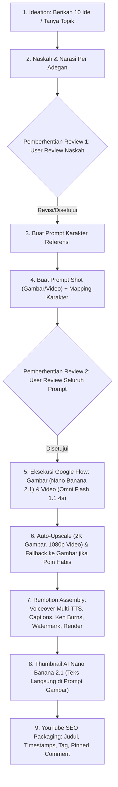

# Panduan Alur Produksi Video Baku (9 Tahapan)

MoneyPrinterMax menerapkan alur kerja yang terstandarisasi ketat agar menghasilkan video berkualitas tinggi dengan visual konsisten, narasi memikat, dan tanpa risiko pemborosan kredit AI.

---

## 🗺️ Diagram Alur 9 Tahapan

---

## 📌 Penjelasan Rinci Setiap Tahap

### Tahap 1: Ideation (Brainstorming Konsep)
- Berikan **10 ide cerita berpotensi viral / high-retention** dengan hook kuat.
- Atau tanyakan topik spesifik apa yang ingin diangkat oleh user.

### Tahap 2: Naskah & Narasi Per Adegan
- Tulis naskah narasi terbagi per adegan (8–12 adegan untuk video panjang, atau 1 adegan dinamis untuk shorts).
- 🛑 **GERBANG REVIEW 1 (WAJIB):** Berhenti dan biarkan user mereview teks narasi terlebih dahulu. Jangan melanjutkan ke tahap visual sebelum naskah disetujui!

### Tahap 3: Prompt Karakter Referensi
- Gaya visual baku (sesuai conversation `f6935784-c606-441d-87fd-2e4df8c517f3`):
  `Simple black stickman character with round white head, thick black outline, flat 2D vector animation style, [setting/tema], minimal details, cinematic 16:9/9:16, no text, [pose]`
- Buat 4–6 karakter acuan dengan latar polos netral (`plain neutral off-white background`), *full body*, pose netral.
- Generate karakter pertama kali dan simpan di `visual/karakter/<nama>.png`.

### Tahap 4: Prompt Shot & Pemetaan Karakter Acuan
- Setiap shot dibagi menjadi Gambar atau Video (4 detik).
- Setiap prompt shot wajib menyertakan tag **📌 Referensi Karakter:** yang menunjuk ke file karakter yang harus diunggah sebagai *ingredient* di Google Flow.

### Tahap 5: Review Seluruh Prompt
- 🛑 **GERBANG REVIEW 2 (WAJIB):** Tampilkan daftar prompt kepada user untuk diperiksa sebelum dikirim ke Google Flow.

### Tahap 6: Eksekusi Google Flow & Auto-Upscale
- **Gambar:** Menggunakan `Nano Banana 2.1`.
- **Video:** Menggunakan `Omni Flash 1.1` berdurasi **wajib 4 detik**.
- **Auto-Upscale:** Script otomatis memilih resolusi **2K** untuk gambar dan **1080p** untuk video saat mengunduh.
- **Credit Fallback:** Jika poin video habis, sistem otomatis beralih membuat gambar dengan Nano Banana 2.1 untuk sisa shot.

### Tahap 7: Editing & Rendering di Remotion
- Sinkronisasi audio dubbing TTS per adegan.
- Pergerakan kamera Ken Burns (zoom in, zoom out, pan, tilt, shake) pada gambar statis.
- *Dynamic playbackRate* pada klip video agar video Omni Flash 4s tidak pernah mengalami freeze.
- Teks caption dinamis per kata & watermark `@channel`.

### Tahap 8: Pembuatan Thumbnail AI
- Menggunakan `Nano Banana 2.1` di Google Flow.
- Teks tipografi judul besar tebal langsung dimasukkan ke dalam prompt gambar AI (bukan diedit manual terpisah).

### Tahap 9: YouTube SEO Packaging
- 4 Opsi Judul High-CTR.
- Deskripsi lengkap dengan Timestamps babak video.
- Tag kata kunci relevan.
- Pinned Comment penarik interaksi penonton.
